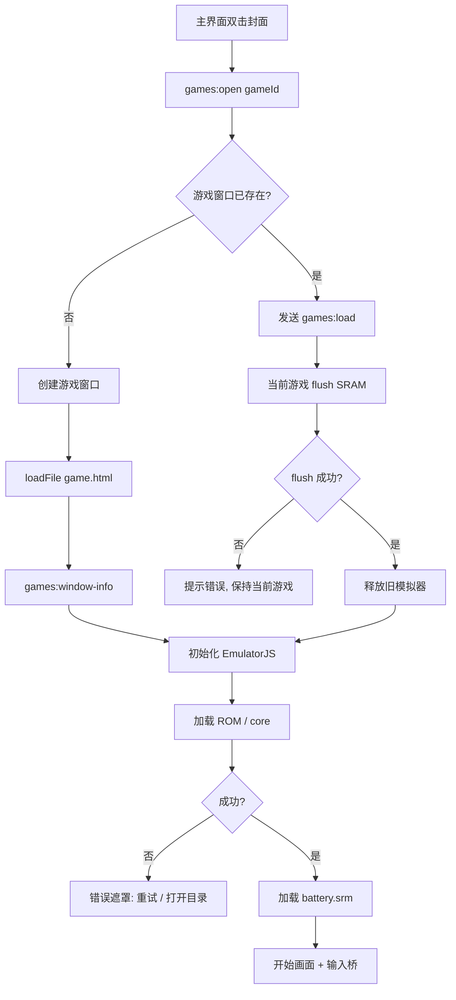
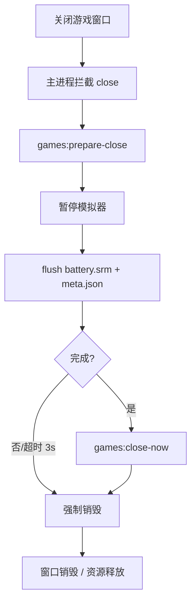
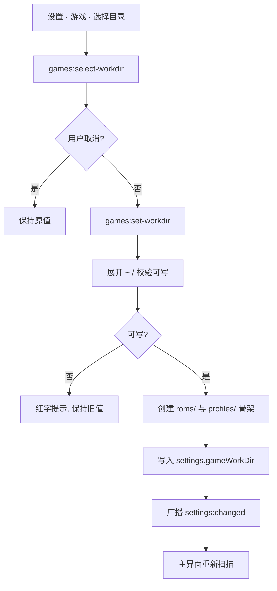

# 13. 游戏工具（EmulatorJS）

> Index: [docs/PRD.md](../PRD.md)

### 13.1 范围与术语

- 本工具在 Vessel 内接入 **EmulatorJS**，支持 5 个引擎：**FC / GBC / GBA / N64 / SFC**。
- EmulatorJS 运行时**离线内置**到仓库，固定版本（当前规划 **v4.2.3**），不依赖 CDN、不联网。
- 功能范围：游戏设置（工作目录 / 按键映射）、主界面游戏库（分类 + 封面）、独立游戏窗口（模拟器 + 控制区 + 存档）。
- 非目标：联机对战、金手指管理、RomM / 在线刮削、多游戏窗口并行、成就系统。
- 术语：
  - **工作目录**：用户指定的游戏根目录，固定包含 `roms/` 与 `profiles/`。
  - **引擎**：`fc` / `gbc` / `gba` / `n64` / `sfc` 五个分类，对应 EmulatorJS 的 core。
  - **游戏**：某个引擎目录下的一个 ROM 文件。
  - **即时存档**：EmulatorJS save state（单个槽位）。
  - **电池存档**：游戏自身写出的 SRAM / save RAM。

### 13.2 工作目录与数据布局

#### 13.2.1 默认值与解析规则

| 场景 | 默认工作目录 |
| --- | --- |
| 打包运行（`app.isPackaged === true`） | `path.join(app.getPath('userData'), 'games')` |
| 未打包运行（`app.isPackaged === false`，即调试模式） | `path.join(app.getAppPath(), 'assets', 'games')` |
| 设置在「游戏 · 工作目录」中指定了非空路径 | 始终使用该路径（展开 `~` 后解析为绝对路径） |

- 设置键：`settings.gameWorkDir`（字符串，默认 `''`）。
- 空字符串表示「自动」：按上表取默认值；界面必须展示**实际解析后的绝对路径**。
- 工作目录可位于任意可写位置；路径中的 `~` 只展开为当前用户主目录。
- 自定义路径必须是已存在目录，或允许应用创建（见 13.2.3）。不可写 / 不存在且创建失败时，设置保存失败并保持旧值，不静默回退默认目录。

#### 13.2.2 目录结构

```text
<workDir>/
  roms/
    fc/        # FC / Famicom / NES ROM
    gbc/       # Game Boy Color ROM
    gba/       # Game Boy Advance ROM
    n64/       # Nintendo 64 ROM
    sfc/       # Super Famicom / SNES ROM
  bios/
    disksys.rom  # FDS BIOS（用户选择后自动复制到此，未配置时不存在）
  profiles/
    <gameId>/  # 每个游戏一个独立目录
      battery.srm
      state.slot1
      state.slot1.png
      meta.json
```

- 正式目录名为 **`profiles`**（复数）；兼容读取旧目录 `profile`（单数）：仅当 `profiles/` 不存在且 `profile/` 存在时，读取 / 写入 `profile/`，不主动迁移。
- 未打包运行时仓库内已有 `assets/games/roms/{fc,gbc,gba,n64,sfc}` 与 `assets/games/profiles/`，可直接用于调试。
- ROM 可放在引擎目录的**直接子文件**，也可放在**子目录**中（如 `roms/fc/name/xxx.nes`）：子目录内（含更深层）的 ROM 以**最外层子目录名**作为显示名称；隐藏文件 / 目录（`.` 开头）与符号链接跳过。
- 封面图允许与 ROM 同目录、同基名的 sidecar 文件（见 13.3.3）。

#### 13.2.3 目录初始化

- 首次扫描 / 首次打开工作目录时，若 `roms/`、`profiles/`、`bios/` 或五个引擎子目录缺失，则自动创建。
- 保存新的自定义工作目录时：
  1. 展开 `~` 并转为绝对路径；
  2. 不可写则返回错误，设置不变；
  3. 可写则创建 `roms/{fc,gbc,gba,n64,sfc}`、`bios/` 与 `profiles/`；
  4. 写入 `settings.gameWorkDir` 并广播设置变更。
- 创建失败不删除用户已有文件，只返回错误并在界面就地提示。

### 13.3 游戏扫描、命名与封面

#### 13.3.1 引擎与 ROM 扩展名

| 引擎 | 目录 | 显示名 | EmulatorJS core | 接受的扩展名（不区分大小写） |
| --- | --- | --- | --- | --- |
| `fc` | `roms/fc/` | FC | `fceumm` | `.nes` `.fds` `.unf` `.unif` |
| `gbc` | `roms/gbc/` | GBC | `gambatte` | `.gbc` |
| `gba` | `roms/gba/` | GBA | `mgba` | `.gba` |
| `n64` | `roms/n64/` | N64 | `mupen64plus_next` | `.z64` `.n64` `.v64` |
| `sfc` | `roms/sfc/` | SFC | `snes9x` | `.sfc` `.smc` `.fig` |

- 分类顺序固定为 `fc → gbc → gba → n64 → sfc`。
- 扩展名匹配**不区分大小写**（`.NES` / `.Z64` 等同样接受）；扩展名不在表中的文件（如 `.txt` / `.md` / `.xxx`）忽略；sidecar 封面图不作为游戏。
- 每个分类内按显示名称做自然排序（`Intl.Collator`，数字按数值比较，忽略大小写）。

#### 13.3.2 显示名称与 gameId

- **显示名称**：
  - 直接放在引擎目录下的 ROM：文件名去掉最后一个扩展名，保留 Region / 语言括号等原始信息（例：`Super Mario World (USA)`）；
  - 子目录中**只有 1 个**匹配 ROM（`roms/<engine>/<name>/xxx.rom`）：使用**最外层子目录名** `<name>` 作为显示名称；运行时加载该 ROM。
  - 子目录中**有多个**匹配 ROM（非 ROM 文件如 `.md` 仍被忽略）：该子目录加载为**独立分类**，分类名为 **`<引擎> - <子目录名>`**（例：`GBC - xxxx`），分类内每个 ROM 以**自己的文件名**（去扩展名）作为显示名称；分类显示数量。
  - 子目录中没有任何匹配 ROM：忽略，不产生分类。
- **gameId**：由「引擎 + 显示名称」生成稳定、文件系统安全的标识：
  - `slug` = 显示名称转小写，连续非字母数字字符替换为 `-`，去首尾 `-`，最长 48 字符；为空时用 `game`；
  - `shortHash` = `sha1('<engine>/<ROM 相对引擎目录的路径，含扩展名>')` 的前 8 位十六进制；
  - `gameId = '<engine>-<slug>-<shortHash>'`（例：`sfc-super-mario-world-usa-1a2b3c4d`）；
  - 同一引擎下重名的不同 ROM（不同扩展名）因 hash 不同仍可区分。
  - 多 ROM 子分类的分类 id 为 `<engine>-section-<sha1(engine/section/目录名) 前 8 位>`，与游戏 id 区分。
- **注意**：重命名 / 移动 ROM 会生成新的 `gameId`，旧存档目录不会自动跟随；PRD 接受该行为，界面可在右键菜单中提示存档目录位置（后续可选）。
- `EJS_gameID`：取 `sha1(gameId)` 前 8 位十六进制转无符号整数，用于 EmulatorJS 内部隔离；同一 `gameId` 稳定不变。

#### 13.3.3 封面

- 优先级从高到低，同目录同基名（去掉 ROM 扩展名）查找：
  1. `<base>.png`
  2. `<base>.jpg`
  3. `<base>.jpeg`
  4. `<base>.webp`
- 命中多个时按上述优先级取第一个；文件名大小写不敏感；封面文件本身不参与 ROM 扫描。
- 封面通过只读协议 `game://cover/<gameId>` 提供给渲染层，不直接暴露 `file://` 路径。
- 未命中时使用**占位封面**：使用主题中性色（`--color-surface-2` 底色 + `--color-fg` / `--color-fg-muted` 文字），不使用彩色渐变；封面文字先**忽略括号及其内容**（区域 / 版本等，不再按括号切分成单词），再按空格、下划线、连字符、点等**连接字符**切分，取前 **2** 个有效单词；最多显示 **16** 个字符或 **8** 个汉字（汉字按 2 个宽度单位计，连接字符不计入上限），**不再显示引擎类型**；不生成 / 不写入任何文件。
- 封面图片按容器等比裁切（`object-fit: cover`），圆角 `--radius-card`，不拉伸。

### 13.4 主界面「游戏」工具

#### 13.4.1 注册与入口

- 工具 id：`games`；TAB 图标：`gamepad`（新增 `assets/icons/gamepad.svg`）；标题「游戏」；说明「双击封面启动游戏」。
- 工具顺序：在 `src/renderer/scripts/tool-order.js` 中默认排在最后（`clipboard` 之后）；未列出的工具仍按原规则追加。
- 只读取当前工作目录，不在主界面提供删除 / 重命名 ROM 的操作。

#### 13.4.2 布局

- 内容区纵向滚动；**顶部不显示工具栏与工作目录路径**，也不提供「修改 / 刷新」按钮；**工具标题行右侧**（与剪贴板刷新按钮位置相同）为**搜索框**，宽 **350px**、高 **26px**、较标题行上移 **4px**（窄窗口自动收缩）；下方展示分类与封面。
- 进入工具页面时自动扫描一次；主窗口重新获得焦点、工作目录变更时也会自动刷新。
- 按引擎分类展示；分类顺序见 13.3.1。**只展示有游戏的分类**；全部为空时显示空状态，搜索无结果时显示「没有匹配的游戏」。
- 分类最上方为 **「最近启动」**（`id: recent`，标题按语言显示「最近启动」/「Recently played」）：仅当存在已启动过的游戏时显示，按 `meta.json` 的 `lastPlayedAt` **倒序**取最近 **8** 个（`GAME_RECENT_LIMIT`，见 `src/shared/game-constants.js`）；同一游戏同时保留在其所属引擎分类或多 ROM 子分类中。
- 各引擎分类之后紧跟该引擎下的多 ROM 子分类（如 `GBC - xxxx`，按分类名自然排序）。
- 每个分类为**手风琴**：
  - 分类标题（可点击）：左侧 `caret-right` 图标（展开时旋转 90°）+ 引擎显示名 + 游戏数量（例：`FC · 3`）；
  - 点击标题整体折叠 / 展开；折叠后不渲染该分类的卡片（DOM 清空），展开时重新按需渲染；
  - 下方为封面网格。
- 网格列数：
  - 主界面（640px 宽）：**固定 8 列**；
  - 间距 `8px`，使用 `repeat(n, minmax(0, 1fr))`。
- 每个游戏卡片：
  - 封面为 1:1 方形，圆角 `--radius-card`，带 1px `--color-border`；
  - 封面下方为名称，字号 11px、最多 2 行、超出省略；完整名称通过悬浮提示展示；
  - 悬浮时封面轻微提亮 / 描边强调色；键盘选中或单击选中时使用强调色描边；
  - 卡片可不显示单独引擎徽标（分类标题已表达）；**启动过的游戏**卡片右上角显示一个强调色小圆点（`played`，来自 `profiles/<gameId>/meta.json` 的 `lastPlayedAt`），未启动过的卡片不显示。
- 空状态：无任何游戏时显示「工作目录中未找到游戏」与提示；搜索无结果时只显示「没有匹配的游戏」。
- **性能（几千个 ROM）**：卡片**分批渲染**（每批 `GAME_TILE_CHUNK_SIZE` = **120** 个，见 `src/renderer/scripts/constants.js`），由 `IntersectionObserver`（根为 `#content`，`rootMargin: 300px`）在分类 / 列表接近视口时加载下一批；未展开的分类不渲染卡片；搜索输入防抖 `DEBOUNCE_MS` = 120ms。

#### 13.4.3 交互

- **搜索**：顶部单行搜索框，输入后按名称**模糊匹配**（忽略大小写；优先子串匹配，其次允许按字符顺序跳字匹配），经 120ms 防抖后过滤；`Enter` 立即应用，`Esc` 清空。过滤结果仍按分类展示，分类计数为匹配数量。
- **单击**卡片：选中（仅视觉选中，不启动），并把该游戏的**完整名称**写入搜索框的 `placeholder`。
- **双击**卡片：调用 `games:open` 打开 / 复用游戏窗口并加载该游戏。
- 选中卡片后按 `Enter`：等同于双击。
- **启动即记录**：双击 / `Enter` 启动游戏时，主进程立即把该游戏的 `meta.json` 的 `lastPlayedAt` 更新为当前时间；返回游戏工具（重新聚焦）后「最近启动」自动按最新顺序排列。
- **刷新时机**：工具挂载时、主窗口重新获得焦点时（节流 500ms）、`settings:changed` 中的工作目录 / 按键映射变化后。
- 扫描进行中显示轻量加载态，不阻塞其它工具；扫描失败显示错误。
- 右键菜单（可选，首版可不做）：在 Finder 中显示 ROM、打开该游戏存档目录。

### 13.5 设置 · 游戏

#### 13.5.1 分区注册

- 设置分区 id：`games`；导航标签「游戏」；图标 `gamepad`；位置在「快捷键」之后、「网络测试」之前。
- 分区内容分为四块：**工作目录**、**FDS BIOS**、**通用按键 + 平台专有按键**、**功能快捷键**。

#### 13.5.2 工作目录

- 控件：
  - 当前实际路径（只读文本，单行省略，悬浮显示完整路径）；
  - 「选择目录」按钮（`dialog:open-dir`）；
  - 「重置为默认」按钮（写回 `settings.gameWorkDir = ''`）；
  - 「打开目录」按钮。
- 选择目录后立即尝试保存；成功后就地刷新显示与实际扫描列表；失败时红字提示且保持旧值。
- 默认路径来源见 13.2.1；界面注明当前是「默认」还是「自定义」。目录输入框与按钮同一行、间距 6px，不展示逐目录解析说明。

#### 13.5.3 FDS BIOS

- 设置键：`settings.gameFdsBios`（字符串路径，默认 `''` = 未配置，**无默认值**）。
- 用于运行 `.fds`（Famicom Disk System）游戏所需的 `disksys.rom`；文件由用户自行准备。
- 控件：当前路径（只读文本，单行省略，悬浮显示完整路径）；「选择文件」按钮（系统文件选择框，筛选 `.rom`，默认定位到当前已选文件）；「清除」按钮（写回空字符串，未配置时禁用）。
- **选择后自动复制**：校验所选文件存在且为普通文件后，复制为 `<workDir>/bios/disksys.rom`（目录不存在时自动创建），再把该**副本路径**写入 `settings.gameFdsBios`；若所选文件已是该副本路径则不重复复制。
- 复制成功后更新界面；失败（如工作目录不可写）红字提示且保持旧值。「清除」只清空配置，不删除已复制的文件。
- 界面以徽标显示「已配置 / 未配置」。
- 仅在打开 `.fds` 游戏且已配置时，游戏窗口设置 `EJS_biosUrl = 'game://bios/disksys.rom'`；协议从该配置路径读取文件。其它引擎 / 后缀不加载 BIOS。

#### 13.5.4 通用按键与平台专有按键

- **通用按键**：`settings.gameCommonKeys`，各平台按需共用：上 / 下 / 左 / 右、A、B、X、Y、L / R（GBC 仅使用方向键与 A / B）。
  - 方向键在 FC / GBC / GBA / SFC 上映射到十字键；在 N64 上映射到**摇杆**。
  - X / Y 仅 SFC 实际使用；L / R 除 FC 外使用；界面仍统一展示，绑定额外键不会造成影响。
- **平台专有按键**：`settings.gameKeymaps`，只保存该平台独有的动作；当前仅 N64：
  - 十字键（`dpadUp/down/left/right`）、Z、C 上 / 下 / 左 / 右。
  - FC / GBC / GBA / SFC 没有专有按键，不显示专有按键卡片。
- 绑定值统一使用 **`KeyboardEvent.code`**（如 `KeyW` / `Space` / `ShiftLeft` / `ArrowUp` / `F5`）或鼠标按钮 **`Mouse0` / `Mouse1` / `Mouse2`**；空字符串表示未绑定。
- 点击键帽进入捕获态：按键 / 鼠标按钮即绑定；`Esc` 取消；`Backspace` / `Delete` 清除；只允许单键，不支持组合键。
- 冲突检测：同一平台内（通用动作 + 专有动作）不允许重复；与功能快捷键不允许重复。冲突时红字提示且拒绝保存。
- 平台专有动作显示徽标「`<引擎> 模拟器专用`」。
- 平台专有按键提供「恢复该平台默认」，需二次确认；不提供「全部恢复默认」。
- 通用按键提供两个预设按钮：**恢复 PC 风格（鼠标）** 与 **恢复传统风格（不使用鼠标）**；预设同时重置 N64 专有按键（传统风格把 N64 Z 设为 `KeyR`，保证全程不使用鼠标）。未自定义时默认 PC 风格。预设按钮行与文字垂直居中，**不显示「已恢复预设」等下方提示**。

**默认值**

| 通用动作 | 默认绑定 |
| --- | --- |
| 上 / 下 / 左 / 右 | `KeyW` / `KeyS` / `KeyA` / `KeyD` |
| A（确认 / 跳跃） | `Space` |
| B（取消 / 射击） | `Mouse0` |
| X | `Mouse1` |
| Y | `KeyJ` |
| L / R | `KeyQ` / `KeyE` |

| 传统风格通用动作 | 默认绑定 |
| --- | --- |
| 上 / 下 / 左 / 右 | `KeyW` / `KeyS` / `KeyA` / `KeyD` |
| A / B | `KeyZ` / `KeyX` |
| X / Y | `KeyC` / `KeyV` |
| L / R | `KeyQ` / `KeyE` |

| N64 专有动作 | 默认绑定 |
| --- | --- |
| 十字键上 / 下 / 左 / 右 | `ArrowUp` / `ArrowDown` / `ArrowLeft` / `ArrowRight` |
| Z | `Mouse1` |
| C 上 / 下 / 左 / 右 | `KeyI` / `KeyK` / `KeyJ` / `KeyL` |

- 动作到 EmulatorJS 控制索引的映射：

| 动作 | 索引 | 动作 | 索引 |
| --- | --- | --- | --- |
| B | 0 | Y | 1 |
| A | 8 | X | 9 |
| L | 10 | R | 11 |
| 十字键上 / 下 / 左 / 右 | 4 / 5 / 6 / 7 | Z | 12 |
| 摇杆右 / 左 / 下 / 上（N64 通用方向） | 16 / 17 / 18 / 19 | C 右 / 左 / 下 / 上 | 20 / 21 / 22 / 23 |

- 鼠标绑定由输入桥转换为对应动作；点击控制区按钮不触发游戏输入。

#### 13.5.5 功能快捷键（全局）

- 存储键：`settings.gameHotkeys`；对五个平台共用，包含 **Start / Select** 与模拟器功能：

| 功能 | 默认绑定 | 行为 |
| --- | --- | --- |
| Start（确认） | `Enter` | 按住 = Start 按下，松开释放 |
| Select（选择） | `ShiftLeft` | 按住 = Select 按下，松开释放 |
| 暂停 / 继续 | `Escape` | 切换暂停；全屏时 `Esc` 先退出全屏 |
| 保存即时存档 | `F5` | 写入 `state.slot1` |
| 读取即时存档 | `F9` | 读取 `state.slot1` |
| 快速前进（按住） | `KeyF` | 按住期间快进，松开恢复 |
| 全屏 | `F11` | 切换窗口全屏 |
| 静音 | `KeyM` | 切换静音 |
| 显示 / 隐藏控制区 | `Tab` | 切换底部控制区 |

- 绑定规则与通用按键相同；输入事件仅在游戏窗口聚焦且模拟器已就绪时生效。

### 13.6 游戏窗口

#### 13.6.1 窗口参数

| 项目 | 值 |
| --- | --- |
| 窗口数量 | **全局唯一**，双击另一个游戏复用同一窗口 |
| 默认尺寸 | 480 × 320 |
| 最小尺寸 | 480 × 320 |
| 最大尺寸 | 1440 × 900 |
| 可缩放 | 是（受最小 / 最大尺寸限制） |
| 全屏 | 支持（原生全屏，全屏时忽略最大尺寸限制） |
| 标题 | `Vessel Games` / 自绘头栏显示当前游戏名称 + 引擎徽标 |
| 层级 | 普通窗口层级（**不始终置顶**）；仍为无边框 panel 外观 |
| 桌面归属 | 绑定打开时所在桌面，不加入所有桌面；切换桌面不跟随 |
| 边框 | 无边框 + 透明 + CSS 自绘圆角（与终端窗口一致） |
| 最小化 | 支持 |
| 最大化 | 禁止（最大尺寸固定 1440 × 900）；全屏按钮可用 |
| 记忆 | 屏幕 / 位置 / 尺寸写入 `game-window.json`（方式同终端 / 文件窗口） |

- 启动时设置 `setVisibleOnAllWorkspaces(false, { visibleOnFullScreen: true, skipTransformProcessType: true })`，绑定打开时所在桌面、不跨桌面跟随；不设置 `alwaysOnTop`。
- 窗口聚焦时与终端窗口一样执行一次「先 `true` 再 `false`」以绑定当前桌面。
- 系统红绿灯隐藏，使用自绘头栏（关闭 / 最小化 / 全屏）；自绘按钮只作用于游戏窗口。

#### 13.6.2 布局

```text
┌──────────────────────────────────────────────┐
│ 自绘红绿灯   游戏名称 · 引擎        状态提示 │  头栏 34px（可拖动）
├──────────────────────────────────────────────┤
│                                              │
│              EmulatorJS 画面                 │  自适应，黑底，等比居中
│  ┌────────────────────────────────────────┐  │
│  │ 确认 选择 暂停 重启 … 适配 全屏 隐藏  │  │  悬浮控制区 44px
│  └────────────────────────────────────────┘  │
└──────────────────────────────────────────────┘
```

- 头栏：高度 34px，左侧自绘红绿灯，中间游戏名（单行省略），右侧引擎徽标与短暂状态提示（保存成功 / 读取成功 / 错误）。
- 画面区：黑色背景；EmulatorJS canvas 等比缩放并居中，不裁切、不拉伸；窗口尺寸变化时通过窗口 `resize` 与 EmulatorJS `handleResize` 重新适配。
- 控制区：**绝对定位悬浮在画面底部**（不占据布局高度），高度 44px、按钮 28px 高、间距 3px（窗口窄时可横向滚动）；从左到右：
  - **确认**（按住 = Start 按下，松开 = 释放）；
  - **选择**（按住 = Select 按下）；
  - **暂停 / 继续**；
  - **重新开始**（EmulatorJS restart）；
  - **保存**（写入即时存档槽 1）；
  - **读取**（读取即时存档槽 1）；
  - **截图**（保存为 PNG，弹出保存对话框）；
  - **快进**（按住）；
  - **静音**（图标随状态切换）；
  - **音量**滑块（0–100，默认 70，实时生效，持久化到 `settings.gameVolume`）；
  - **适配画面**：按游戏宽高比调整窗口，消除左右黑边；
  - **全屏**；
  - 最右侧 **隐藏控制区**（`chevron-down`）。
- 控制区隐藏时：
  - 仅隐藏悬浮层，**画面区尺寸不变**；
  - 右下角保留一个半透明悬浮按钮（`chevron-up`），用于恢复控制区；
  - 隐藏状态持久化到 `settings.gameControlsHidden`，下次打开游戏窗口沿用。
- **全屏**：进入原生全屏后自动隐藏头栏与悬浮控制区，画面铺满整个屏幕；退出全屏时恢复进入前的控制区显隐状态（`games:fullscreen` 事件驱动，避免恢复后头栏丢失）。`Esc` 优先退出全屏，`F11` 切换全屏。
- **适配画面**：`games:fit-window` 接收当前游戏宽高比，在最小 / 最大尺寸与当前屏幕工作区内计算窗口尺寸（标题栏高度 34px 单独计入），保持窗口居中，消除左右黑边。

#### 13.6.3 加载、错误与状态

- 双击游戏后立即显示游戏窗口与加载遮罩：游戏名、引擎、加载动画；加载完成后遮罩淡出并开始画面。
- 加载失败（ROM 读取失败、核心加载失败、不支持的格式）显示错误遮罩：错误摘要 + 「重试」+「打开目录」；不自动关闭窗口。
- 保存 / 读取 / 静音 / 快进等操作在头栏显示 1.5 秒的轻量提示；失败用危险色。
- **失焦自动暂停**：游戏窗口失去焦点时自动暂停模拟器；恢复焦点时若这次暂停是「因失焦自动触发」且此前处于播放状态，则自动继续。用户手动暂停后失焦，重新聚焦时保持暂停（不自动继续）。
  - 用 150ms 的短暂延时确认窗口是否真的失去焦点，避开进入 / 退出全屏、系统动画等瞬态失焦；
  - 自动暂停时同时 flush 电池存档，并在头栏显示一次「已暂停」提示；
  - 用户手动点「继续」或按暂停快捷键后，清除「自动暂停」标记。
- 窗口最小化或隐藏时同样自动暂停并 flush 电池存档；恢复时按上述「自动暂停」规则决定是否继续播放。

#### 13.6.4 生命周期与关闭

- 首次打开 / 复用窗口的加载流程见 13.10。
- 关闭窗口（自绘红灯 / `Cmd+W` / 系统关闭）：
  1. 主进程拦截 `close`，向渲染层发送 `games:prepare-close`；
  2. 渲染层暂停模拟器、flush 电池存档；
  3. 渲染层调用 `games:close-now`；
  4. 主进程销毁窗口。
  - 3 秒内未完成则强制销毁，最多丢失最近一次自动 flush 之后的数据。
- 切换游戏（窗口已打开时双击另一个游戏）：
  1. 主进程向现有窗口发送 `games:load`；
  2. 渲染层先 flush 当前游戏电池存档并释放当前 EmulatorJS 实例；
  3. 再加载新游戏；若 flush 失败，中止切换并提示错误，当前游戏保持暂停。
- 应用退出（`before-quit`）：若游戏窗口存在，请求 flush 并最多等待 2 秒后继续退出（不阻塞退出）。
- 窗口销毁时释放 EmulatorJS、音频、定时器、输入监听与 `ResizeObserver`。

### 13.7 EmulatorJS 集成

#### 13.7.1 运行时文件

- 固定版本目录：`assets/emulatorjs/<version>/`（当前规划 `4.2.3`），至少包含：
  ```text
  assets/emulatorjs/4.2.3/
    loader.js
    emulator.min.js
    emulator.min.css
    gamepad.js
    storage.js
    version.json
    cores/
      fceumm/…
      gambatte/…
      mgba/…
      mupen64plus_next/…
      snes9x/…
  ```
- 由构建脚本（shell）从 EmulatorJS 官方发布包获取并校验，不手工散落文件；具体文件清单以官方发布包为准。
- 打包时 `assets/emulatorjs/**` 已加入 `asarUnpack`（WASM / Worker 需要真实文件路径）；`assets/games/**` 排除，避免把调试 ROM / 存档打进产物。
- **许可**：EmulatorJS 为 **GPL-3.0**；本项目已整体切换为 **GPL-3.0-only**，仓库根目录的 `LICENSE` 为 GPLv3 全文，`THIRD_PARTY_NOTICES.md` 记录 EmulatorJS 版本、来源与打包路径。详见 13.11。

#### 13.7.2 加载协议与隔离

- 游戏窗口使用独立页面 `src/renderer/game.html`，通过 `loadURL('game://app/src/renderer/game.html')` 加载；`contextIsolation: true`、`nodeIntegration: false`、`sandbox: false`（与其它副窗口一致）。页面自身也是 `game://app` 源，避免 `file://` 到自定义协议的跨源限制。
- 通过自定义只读协议 `game://` 提供：
  - `game://app/...` → 仅允许 `assets/emulatorjs/<version>/` 与 `src/renderer/` 下的文件（含 EmulatorJS 运行时与页面脚本 / 样式）；
  - `game://rom/<gameId>` → 当前扫描结果中对应的 ROM 文件；
  - `game://cover/<gameId>` → sidecar 封面。
- 协议处理器必须：
  - 只允许访问上述白名单根目录；
  - 对 `gameId` 做白名单校验（必须是当前扫描结果）；
  - 拒绝路径穿越（`..`、绝对路径、符号链接越界）；
  - 返回正确的 MIME / `Content-Length`，支持 Range（N64 大文件读取需要）。
- 页面 CSP 至少允许：`default-src 'self' game: blob: data:`、`script-src 'self' 'unsafe-eval' 'wasm-unsafe-eval' game:`（EmulatorJS 核心用 `eval` 启动，必须保留 `'unsafe-eval'`；页面只加载本地可信内容）、`worker-src 'self' blob: game:`、`connect-src 'self' game: blob: data:`、`img-src 'self' game: data: blob:`、`media-src 'self' game: blob:`。
- 若启用 `EJS_threads`（N64 推荐）：页面响应需带 `Cross-Origin-Opener-Policy: same-origin` 与 `Cross-Origin-Embedder-Policy: require-corp`，协议资源带 `Cross-Origin-Resource-Policy: same-origin`；不满足时回退到非线程模式并在日志中记录。
- 不开启 `webSecurity: false`，不向页面暴露 Node 能力。

#### 13.7.3 EmulatorJS 配置

- 每个游戏加载时设置：
  - `EJS_player = '#game-root'`；
  - `EJS_core` = 对应引擎 core（见 13.3.1）；
  - `EJS_gameUrl = 'game://rom/<gameId>'`；
  - `EJS_gameName` = 显示名称；
  - `EJS_gameID` = 13.3.2 计算的整数；
  - `EJS_pathtodata = 'game://app/assets/emulatorjs/4.2.3/'`；
  - `EJS_startOnLoaded = true`；
  - `EJS_volume` = `settings.gameVolume`；
  - `EJS_biosUrl`：仅 `.fds` 游戏且 `settings.gameFdsBios` 已配置时为 `game://bios/disksys.rom`（Famicom Disk System BIOS），其余情况不设置 / 为空；
  - `EJS_disableLocalStorage = true`；`EJS_cacheConfig = { enabled: false }`（避免在 IndexedDB 留下 ROM 副本）；
  - `EJS_language = 'en-US'`、`EJS_disableAutoLang = false`（固定语言，避免向不存在的 `localization/<系统语言>.json` 发请求）；
  - 不设置 `EJS_defaultControls`：游戏输入统一由输入桥调用 `EJS_emulator.gameManager.simulateInput(player, index, value)` 注入；启动后清空 EmulatorJS 自身的键盘映射，避免物理按键被处理两次；
  - `EJS_onGameStart`：隐藏加载遮罩、启动输入桥、加载电池存档并开始 15 秒自动 flush 定时器；
  - `EJS_Buttons` 全部隐藏，配合 CSS 隐藏默认控制栏。
- **隐藏默认栏**：不使用 EmulatorJS 内建菜单栏 / 按钮；页面加载后对 EmulatorJS 的控制栏容器注入 `display: none`（不修改 EmulatorJS 源文件），所有操作走自绘控制区。
- **启动按钮**：若 EmulatorJS 仍显示开始画面，由游戏窗口在加载完成后自动触发开始（用户双击已是手势，满足音频自动播放要求）。

#### 13.7.4 存档与读取

- **电池存档**：
  - 保存：渲染层每 15 秒调用 `EJS_emulator.gameManager.getSaveFile()`（会先 flush），内容变化（哈希）时写入 `profiles/<gameId>/battery.srm`（原子写：临时文件 + rename）；
  - 自动时机：每 15 秒、暂停、失焦自动暂停、最小化 / 隐藏、关闭、切换游戏、应用退出；
  - 读取：游戏启动后若 `battery.srm` 存在，写入 EmulatorJS 的 `getSaveFilePath()` 并调用 `gameManager.loadSaveFiles()`；使用固定版本已验证的接口，升级 EmulatorJS 时做回归。
  - 无存档时不报错。
- **即时存档（槽 1）**：
  - 保存：调用 `gameManager.getState()` 取得 state，调用 `gameManager.screenshot()` 取得 PNG 截图；`state` 写入 `state.slot1`，截图写入 `state.slot1.png`；
  - 读取：调用固定版本已验证的 `EJS_emulator.gameManager.loadState(uint8)`；不在启动时自动读取；
  - 不自动读取即时存档；只有用户点击「读取」或按快捷键 `F9` 才读取；
  - 读取失败（文件不存在 / 格式不兼容）头栏提示错误，不崩溃、不覆盖旧存档。
- 所有存档写入都限制在 `profiles/<gameId>/` 内；`gameId` 必须匹配当前窗口游戏。
- 原子写失败时保留旧文件；`meta.json` 写入失败不影响存档本身。

#### 13.7.5 `meta.json`

```json
{
  "version": 1,
  "gameId": "sfc-super-mario-world-usa-1a2b3c4d",
  "engine": "sfc",
  "romName": "Super Mario World (USA)",
  "romRelativePath": "roms/sfc/Super Mario World (USA).sfc",
  "createdAt": 1760000000000,
  "lastPlayedAt": 1760000000000,
  "playSeconds": 120
}
```

- `lastPlayedAt` 在启动、暂停、关闭、切换游戏时更新；`playSeconds` 在暂停、关闭、切换游戏时更新；非机密，明文 JSON。
- 文件不存在时自动创建；损坏时覆盖写回最小结构。

#### 13.7.6 输入桥

- 游戏窗口捕获键盘 / 鼠标事件，按 `settings.gameKeymaps` 与 `settings.gameHotkeys` 转换为 EmulatorJS 输入：
  - 通用 / 专有动作 → `EJS_emulator.gameManager.simulateInput(player, index, value)`（N64 通用方向使用摇杆索引 16–19）；
  - 功能快捷键 → 暂停 / 保存 / 读取 / 快进 / 全屏 / 静音 / 显隐控制区；
  - 鼠标左 / 右键 → 对应动作（默认 B / N64 Z）；仅当指针位于画面区时生效，控制区与头栏不触发；
  - 阻止右键菜单与已映射按键的默认行为。
- 窗口失焦、最小化、隐藏、切换游戏时释放所有按下的键，避免「按键卡住」。
- 对 EmulatorJS 无法直接映射的按键，使用合成 `KeyboardEvent`（带正确 `code` / `key` / `keyCode`）派发到 EmulatorJS 的输入目标；该方案与固定版本一起验证。

### 13.8 对外接口（IPC）

#### 13.8.1 invoke

| 通道 | 参数 | 返回 | 说明 |
| --- | --- | --- | --- |
| `games:scan` | — | `{ ok, workDir, resolvedWorkDir, isDefault, engines, errors? }` | 扫描工作目录。`engines: [{ id, label, games: [{ id, name, engine, label, romRelativePath, size, mtime, played, coverUrl }] }]`（引擎分类之后可跟 `<engine>-section-<hash>` 的多 ROM 子分类）；存在已启动过的游戏时，首项为 `id: recent`（`label` 为空，渲染层按语言显示）的「最近启动」分类，按 `lastPlayedAt` 倒序最多 8 个。只接受来自主窗口的请求。 |
| `games:open` | `{ gameId }` | `{ ok, error? }` | 打开 / 复用游戏窗口并加载游戏，同时更新该游戏 `meta.json` 的 `lastPlayedAt`。`gameId` 必须存在于最近一次扫描结果。只接受来自主窗口的请求。 |
| `games:window-info` | — | `{ ok, game, settings: { gameCommonKeys, gameKeymaps, gameHotkeys, gameVolume, gameControlsHidden, hasFdsBios } }` | 游戏窗口启动时读取当前游戏与设置；`hasFdsBios` 表示已配置的 FDS BIOS 当前是否有效；只接受来自游戏窗口的请求。 |
| `games:save-sram` | `{ gameId, data: Uint8Array \| ArrayBuffer }` | `{ ok, error? }` | 写入 `battery.srm`；`gameId` 必须匹配当前窗口游戏。 |
| `games:load-sram` | `{ gameId }` | `{ ok, data?: Uint8Array, exists, error? }` | 读取 `battery.srm`；不存在返回 `exists: false`。 |
| `games:save-state` | `{ gameId, state: Uint8Array \| ArrayBuffer, screenshot?: Uint8Array \| ArrayBuffer }` | `{ ok, error? }` | 写入 `state.slot1` 与可选 `state.slot1.png`。 |
| `games:load-state` | `{ gameId }` | `{ ok, state?: Uint8Array, screenshot?: Uint8Array, exists, error? }` | 读取槽 1。 |
| `games:touch` | `{ gameId, playSeconds }` | `{ ok, error? }` | 更新 `meta.json` 的 `lastPlayedAt` / `playSeconds`。 |
| `games:load-ready` | `{ gameId }` | `{ ok, error? }` | 复用窗口切换游戏时，渲染层 flush 旧游戏成功后确认新游戏；主进程此时才更新「当前游戏」。只接受来自游戏窗口的请求。 |
| `games:close-now` | — | `{ ok }` | 强制销毁游戏窗口；只接受来自游戏窗口的请求。 |
| `games:select-workdir` | — | `{ path }` 或 `null` | 系统目录选择对话框；取消返回 `null`。 |
| `games:set-workdir` | `{ path: string }` | `{ ok, workDir, resolvedWorkDir, isDefault, error? }` | 校验 / 创建目录结构并写入 `settings.gameWorkDir`；空字符串表示恢复默认。 |
| `games:select-bios` | — | `{ path }` 或 `null` | 选择 FDS BIOS（`disksys.rom`）文件的系统对话框；取消返回 `null`。只接受主窗口 / 设置窗口请求。 |
| `games:set-bios` | `{ path: string }` | `{ ok, path?, error? }` | 校验文件存在且为普通文件后复制为 `<workDir>/bios/disksys.rom`，并把副本路径写入 `settings.gameFdsBios`；空字符串清除配置（不删除文件）。只接受主窗口 / 设置窗口请求。 |
| `games:open-workdir` | — | `{ ok, error? }` | 在系统文件管理器中打开当前解析后的工作目录。 |
| `games:open-profile` | `{ gameId? }` | `{ ok, path?, error? }` | 打开指定游戏（缺省为当前窗口游戏）的存档目录；不存在则创建。 |
| `games:keymap-set` | `{ common }` / `{ engine: 'n64', maps }` / `{ all }` / `{ common, all }` | `{ ok, maps, error? }` | 保存通用按键 / 平台专有按键；校验同平台重复、与功能快捷键冲突、非法键。 |
| `games:hotkey-set` | `{ maps: object }` | `{ ok, maps, error? }` | 校验后写入 `settings.gameHotkeys`。 |
| `games:set-controls-hidden` | `{ hidden: boolean }` | `{ ok, hidden }` | 写入 `settings.gameControlsHidden`；游戏窗口使用。 |
| `games:set-volume` | `{ volume: number }` | `{ ok, volume }` | 夹取 0–1 后写入 `settings.gameVolume`。 |
| `games:fit-window` | `{ aspect: number }` | `{ ok, width, height, error? }` | 按游戏宽高比调整游戏窗口尺寸，消除左右黑边；只接受游戏窗口请求。 |

#### 13.8.2 事件（主 → 渲染）

| 通道 | 负载 | 说明 |
| --- | --- | --- |
| `games:load` | `{ game }` | 复用已打开的游戏窗口时切换游戏；渲染层负责 flush + 释放 + 重新加载。 |
| `games:prepare-close` | — | 请求游戏窗口 flush 并存档后关闭；只发给游戏窗口。 |
| `games:workdir-changed` | `{ workDir, resolvedWorkDir }` | 工作目录变更后通知主窗口重新扫描（也通过 `settings:changed` 兜底）。 |
| `games:fullscreen` | `{ fullscreen: boolean }` | 游戏窗口进入 / 退出原生全屏；渲染层据此隐藏 / 恢复头栏与控制区。 |

#### 13.8.3 安全与来源校验

- `games:scan` / `games:open` 只接受主窗口 webContents。
- 存档读写 / `games:window-info` / `games:close-now` / `games:set-controls-hidden` 只接受游戏窗口 webContents，且 `gameId` 必须与窗口当前游戏一致。
- 工作目录设置只接受设置窗口或主窗口请求。
- 所有文件操作使用 `path.join(profileDir, name)` 后校验结果仍在 `profileDir` 内，不拼接用户可控的子路径。
- 渲染层永远拿不到任意路径读写能力。

### 13.9 持久化与清理

| 数据 | 位置 | 结构 / 说明 | 持久性 |
| --- | --- | --- | --- |
| 游戏设置 | `settings.json` | `gameWorkDir`、`gameFdsBios`、`gameCommonKeys`、`gameKeymaps`、`gameHotkeys`、`gameVolume`、`gameControlsHidden` | 持久；重启保留（`gameFdsBios` 指向 `<workDir>/bios/disksys.rom` 副本） |
| 游戏窗口几何 | `game-window.json`（数据目录） | 同 `terminal-window.json`：`{ display, bounds }` | 持久；窗口移动 / 缩放 / 关闭时写入 |
| ROM | `<workDir>/roms/<engine>/` | 用户文件，应用只读 | 持久 |
| FDS BIOS | `<workDir>/bios/disksys.rom` | 选择文件后自动复制到此；`settings.gameFdsBios` 指向该副本 | 持久；清除配置不删除文件 |
| 存档 | `<workDir>/profiles/<gameId>/` | `battery.srm`、`state.slot1`、`state.slot1.png`、`meta.json` | 持久 |
| 封面 | ROM 同目录 | `<base>.png/.jpg/.jpeg/.webp` | 用户文件，应用只读 |

- `settings.json` 新增键的默认值集中在 `src/shared/game-constants.js`（常量文件），不在业务代码散落字面量。
- `app:clear-data` 增加删除 `game-window.json`；**不删除** `roms/`、`profiles/`、`settings.json` 中的游戏设置。
- 启动时数据文件清单（`describeDataFiles`）增加 `game-window.json` 与默认工作目录路径，便于排查。
- 游戏窗口位置记忆方式与终端 / 文件窗口一致：同屏沿用、越界夹回工作区、换屏 / 无记录时默认尺寸居中。

### 13.10 核心流程

#### 13.10.1 打开游戏



#### 13.10.2 关闭 / 切换 / 退出



#### 13.10.3 设置工作目录



### 13.11 构建、许可与风险

- **构建**：
  - EmulatorJS 文件随 `assets/emulatorjs/` 打包，并把 `assets/emulatorjs/**` 加入 `asarUnpack`（避免 asar 内 WASM / Worker 读取限制）；`assets/games/**` 从打包文件中排除（只用于未打包调试，ROM / 存档不随应用分发）；`package.json` 的 `vessel` 段新增 `gameWindow` 配置（尺寸 / 最小 / 最大）；
  - 新增常量文件 `src/shared/game-constants.js`（引擎、扩展名、默认按键、窗口默认值），主进程与渲染层共用；
  - `README.md` 不新增游戏功能说明（保持仅图标 + 概述）；游戏细节只在本章节。
- **许可（已确认）**：
  - 本项目整体采用 **GPL-3.0-only**（`package.json` 的 `license` 与仓库根目录 `LICENSE`）。
  - EmulatorJS 同为 **GPL-3.0**，离线内置分发符合整体许可；`THIRD_PARTY_NOTICES.md` 记录其版本、来源与打包路径。
  - 分发时需随应用提供对应源码 / 许可文本；本项目源码仓库与 GPLv3 文本已满足该要求。
- **技术风险**：
  - EmulatorJS 的部分存档 / 读档能力未在公开文档中完整暴露，需锁定 v4.2.3 并做集成验证；升级版本必须回归存档、按键映射、N64 性能。
  - N64 核心体积 / 性能较高，需验证是否启用 `EJS_threads` 以及 COOP / COEP 对自定义协议的影响。
  - 自定义协议需支持 Range 与正确 MIME，否则大 ROM / WASM 可能加载失败。
- **版本锁定**：EmulatorJS 版本升级属于依赖变更，需同步本章节、`assets/emulatorjs/` 与构建脚本。

### 13.12 验收清单

- [ ] 设置中出现「游戏」分区；工作目录默认值在打包 / 未打包两种场景正确。
- [ ] 工作目录切换后可创建 `roms/{fc,gbc,gba,n64,sfc}` 与 `profiles/`，失败有明确提示。
- [ ] 主界面出现「游戏」TAB；8 列；分类标题与封面正确。
- [ ] sidecar 封面命中与占位封面都正常；无游戏时有空状态；主界面不显示「修改 / 刷新」按钮。
- [ ] `roms/<engine>/<文件夹>/xxx.rom` 单 ROM 子目录以文件夹名展示；多 ROM 子目录生成 `<引擎> - <文件夹>` 独立分类（非 ROM 文件忽略）；扩展名大小写不敏感，非本引擎扩展名（`.txt` / `.md` / `.xxx`）被忽略。
- [ ] 设置 · 游戏选择 `disksys.rom` 后自动复制到 `<workDir>/bios/disksys.rom`（默认未配置、可清除）；配置后 `.fds` 游戏可正常加载 BIOS，未配置时提示加载失败。
- [ ] 启动过的游戏出现在顶部「最近启动」分类，最近一次启动的排最前（最多 8 个）；其卡片右上角有强调色圆点，未启动过的没有。
- [ ] 顶部搜索支持大小写不敏感的模糊匹配，`Esc` 可清空；无匹配时显示空状态。
- [ ] 分类标题可点击折叠 / 展开；折叠的分类不渲染卡片。
- [ ] 占位封面使用主题中性色（无彩色渐变），忽略括号内容并显示前两个有效单词（连接字符不计入长度）；几千个 ROM 时分批渲染、滚动基本流畅。
- [ ] 双击封面打开游戏窗口并加载对应引擎；再次双击其它游戏复用同一窗口。
- [ ] 游戏窗口默认 / 最小 480×320、最大 1440×900、可全屏、不始终置顶、不跨桌面跟随；拖拽后尺寸 / 位置可恢复。
- [ ] 游戏窗口失去焦点时自动暂停并 flush 电池存档；重新聚焦时仅对「自动暂停」自动继续，手动暂停不自动继续。
- [ ] 控制区悬浮在画面上，显示 / 隐藏不改变游戏画面尺寸；包含确认 / 选择 / 暂停 / 重启 / 保存 / 读取 / 截图 / 快进 / 静音 / 音量 / 适配画面 / 全屏 / 隐藏。
- [ ] 适配画面后窗口左右无黑边；全屏为真全屏且自动隐藏标题栏与控制区，退出后恢复。
- [ ] 五个引擎均能加载并进入游戏（GBC 使用 `gambatte` 核心与 `.gbc` ROM）；通用方向键在 N64 映射到摇杆；N64 专有键标注「N64 模拟器专用」；Start / Select 在功能快捷键中可绑定；鼠标左 / 右键可映射。
- [ ] 按键冲突被阻止；设置重启后保留。
- [ ] 电池存档每 15 秒 / 暂停 / 关闭时写入 `profiles/<gameId>/battery.srm`；下次启动自动读取。
- [ ] 即时存档保存 / 读取成功，生成 `state.slot1` 与 `state.slot1.png`。
- [ ] 关闭 / 切换 / 退出时存档 flush；3 秒超时不会卡住窗口。
- [ ] 扫描、打开、存档读写均通过 IPC 来源校验；无法读写工作目录外的任意文件。
- [ ] 打包后离线可用，不请求 CDN；EmulatorJS 许可声明已按要求补齐。
